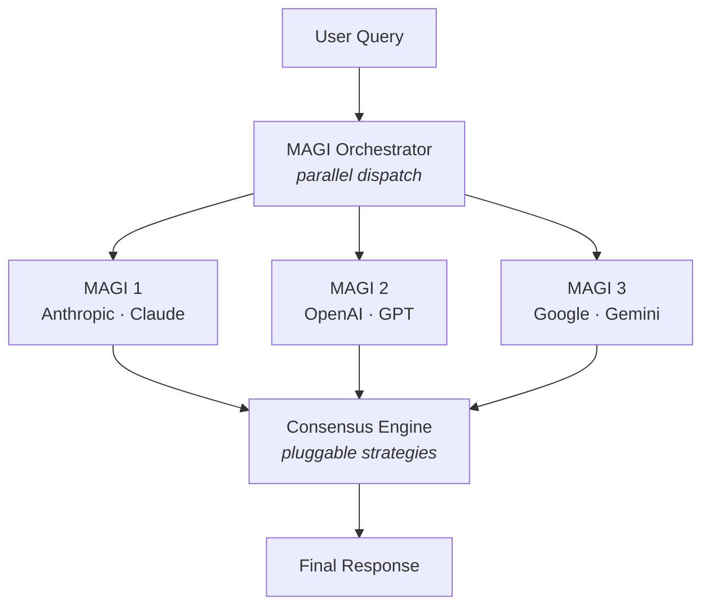

# MAGI

🔺🔻🔺

[](https://github.com/retrobit/magi/actions/workflows/ci.yml)
[](LICENSE)
[](https://www.typescriptlang.org)
[](https://kit.svelte.dev)

**Three AI models. One consensus.**

🔴 **[Try the live demo →](https://magi-consensus.vercel.app)** — free tier, no keys needed.

<p align="center">
  <a href="docs/media/magi-demo.mp4">
    
  </a>
</p>

MAGI sends your question to three frontier models from different providers in parallel, then reconciles their answers into one — by synthesis, structured voting, or a multi-round debate you can watch unfold. Inspired by the MAGI system (IYKYK): three independent supercomputers that deliberate to reach consensus.

## 🤔 Why three?

Any single LLM can hallucinate, hedge, or miss context. Querying three models from different providers and reconciling their answers buys you:

- **Higher confidence** — where all three agree, the answer is likely reliable.
- **Broader coverage** — different training data and reasoning patterns; one model's blind spot is often another's strength.
- **Built-in fact-checking** — disagreement surfaces uncertainty a single model would gloss over silently.
- **Provider independence** — if one provider has an outage, the other two still answer.

## ⚡ How it works



1. **Parallel dispatch** — the query streams to all three models at once, so total latency tracks the slowest model, not the sum.
2. **Independent answers** — each model responds without seeing the others, then a consensus strategy reconciles them (streaming live).
3. **Resilient** — if one or two models fail, MAGI proceeds on what it has and flags the partial result.
4. **Multi-turn** — follow-ups carry context: each node replays only its _own_ prior turns, and the consensus builds on prior consensuses. Anthropic prompt-cache breakpoints keep replayed threads cheap on every follow-up.

## 🧠 Consensus strategies

The consensus engine is pluggable:

- **Synthesis** _(default)_ — one model reads all three answers, reconciles agreements and disagreements, and writes a single unified response. The synthesizer seat is configurable (`consensusNode`, default `MAGI_1`).
- **Structured Voting** — each node scores its peers' answers (anonymized as Candidate A/B) from 0–10; the highest aggregate wins and is shown **verbatim** under a tally table. No extra model call beyond the three jurors, and it works on every tier (lenient score parsing, no structured-output requirement).
- **Multi-Round Debate** _(flagship)_ — each node stakes out a position, then reads anonymized peers and revises across 2–5 rounds (default 3) before a final synthesis. Stops early on convergence; each round is shown per node.
- **None** — skip consensus entirely and compare the three raw answers side by side.

## ✨ Features

- **Multi-turn conversations** — per-node transcripts, persisted per tier in `localStorage`; each node replays only its own thread.
- **Live streaming UI** — answers and consensus stream token-by-token, with a "N / 3 responded" progress count and an auto-layout that follows the run (nodes → balanced → consensus).
- **Token & cost awareness** — per-node and cumulative token counts, per-model context-window gauges, prompt-cache hits, and a per-provider daily spend readout.
- **Resilient by design** — automatic model-health tracking (recently-failed models are skipped), per-node and consensus stall guards, partial-consensus fallback, and per-node retry that re-runs one node without re-billing the others.
- **Editable temperaments** — give each MAGI a dispositional lens, or write your own persona (see **Temperaments** below).
- **Deliberation controls** — Opinionated and Collaborative modes, a 2–5 round debate ceiling, and seeded per-turn peer-order shuffling to wash out position bias.
- **Polish** — dark/light theming with two palettes (three more ship hidden behind a flag) and reduced-motion modes, syntax-highlighted markdown, a filterable run-history panel with JSON export, and an animated ASCII intro.
- **Bring your own key** — on deployments with `PUBLIC_BYOK_ENABLED=true`, visitors paste their own provider keys to unlock tiers on their own billing; keys stay browser-local and are never logged or stored server-side.

## 🎭 Temperaments

Each MAGI can answer through an optional **temperament** — a dispositional lens injected as a system prompt:

| Node   | Temperament      | Guiding question                 |
| ------ | ---------------- | -------------------------------- |
| MAGI 1 | 🧊 Rationalist   | "What do the facts say?"         |
| MAGI 2 | 🛡️ Caretaker     | "Who does this affect, and how?" |
| MAGI 3 | 🔥 Individualist | "What feels true?"               |

Temperaments are **off by default** (toggle with 🧠, or `temperaments: true` in the API). Each seat's **name and persona are editable** via the ✏️ editor — rename it, rewrite the persona, or reset to the built-in default; edits persist (sparsely) in `localStorage` and are validated server-side.

When enabled, two consensus controls appear (both **synthesis-only**, off by default): **Consensus Temperament** gives the synthesizer its own lens, and **Temperament Awareness** tells it the actual lens each node used this turn — its real label and persona — so it can surface _why_ answers diverge without guessing.

> For direct-API models, temperaments are sent as a native `system` message; for OpenRouter they're prepended to the prompt, since free-tier models don't reliably support the `system` role.

## 🎚️ Model tiers

Pick a tier to trade quality against cost:

| Tier         | Anthropic         | OpenAI        | Google                |
| ------------ | ----------------- | ------------- | --------------------- |
| **Frontier** | Claude Opus 5.5   | GPT-6.2 Astra | Gemini 4 Carbon       |
| **Balanced** | Claude Sonnet 5.5 | GPT-6.2 Sol   | Gemini 4 Hydrogen     |
| **Budget**   | Claude Haiku 5.5  | GPT-6 Luna    | Gemini 3.5 Flash Lite |
| **Free**     | \*                | \*            | \*                    |

> The **Free** tier routes all three nodes through [OpenRouter](https://openrouter.ai), fetching the currently-live model list dynamically. A short ranked list of probe-verified models seats first (reliability outranks variety, so two seats may share a provider); any gap is filled with a provider-diverse pick from the rest of the live pool. Set `OPENROUTER_API_KEY` to enable it.
>
> ⚠️ Free-tier models are community / promotional endpoints and can be flaky — retry or swap any node that stalls or fails. A caution icon by the tier selector flags this in-app.

## 🚀 Quick start

```bash
bun install
cp .env.local.example .env.local   # then add your keys
bun run dev
```

You'll need API keys from [Anthropic](https://console.anthropic.com), [OpenAI](https://platform.openai.com), and [Google AI Studio](https://aistudio.google.com) for the paid tiers, and/or [OpenRouter](https://openrouter.ai/keys) for the free tier.

| Variable                       | Required   | Description                          |
| ------------------------------ | ---------- | ------------------------------------ |
| `ANTHROPIC_API_KEY`            | Paid tiers | Claude models                        |
| `OPENAI_API_KEY`               | Paid tiers | GPT models                           |
| `GOOGLE_GENERATIVE_AI_API_KEY` | Paid tiers | Gemini models                        |
| `OPENROUTER_API_KEY`           | Free tier  | OpenRouter models                    |
| `MAGI_API_KEY`                 | No         | Require Bearer-token auth on the API |

Every other variable (admin keys and monthly caps for the budget readout, OpenRouter attribution, log level, the `PUBLIC_*` demo/BYOK flags, the Upstash `KV_REST_API_*` pair) is optional and documented inline in [.env.local.example](.env.local.example). Vercel-specific values: [DEPLOY.md](DEPLOY.md#environment-variables).

<details>
<summary>Development commands</summary>

```bash
bun run dev          # Start dev server
bun run build        # Production build
bun run preview      # Preview production build
bun run check        # Type-check
bun run test         # Run unit tests
bun run verify       # check + lint + test:coverage + build — CI's gate
bun run lint         # Check formatting + linting
bun run format       # Auto-format with Prettier
```

In dev, a 🐞 button opens a debug panel that injects synthetic error / context-limit states, plus a **states catalog** enumerating every status, result, and progress indicator. Both are gated by `import.meta.env.DEV` and never ship to production. For manual UI testing, see [TESTING.md](TESTING.md).

</details>

## 🔌 API

MAGI exposes a small SSE-streaming HTTP API. The full machine-readable spec lives in [openapi.yaml](openapi.yaml) (OpenAPI 3.1) — feed it to Swagger UI, Postman, or your codegen of choice.

<details>
<summary>Endpoints, a minimal request, and a client example</summary>

- `POST /api/magi` — run a query; streams the result as Server-Sent Events.
- `GET /api/magi/models?tier=<tier>` — available models for a tier (paid: static registry; free: live from OpenRouter).
- `GET /api/magi/budget` — each paid provider's spend and remaining credit (`?force=1` bypasses the 60 s server cache).

`MAGI_API_KEY`, when set, is required as `Authorization: Bearer <key>` on `POST /api/magi` and `GET /api/magi/budget`.

```bash
curl -N http://localhost:5173/api/magi \
  -H 'Content-Type: application/json' \
  -d '{ "query": "What is consciousness?", "tier": "free", "strategy": "synthesis" }'
```

The stream is a sequence of `event: <name>` / `data: <JSON>` frames separated by a blank line — split on `\n\n`, then read the two lines of each frame. Every request field, event payload, error status and header is specified in [openapi.yaml](openapi.yaml); that file is the contract.

**Rate limiting:** 10 req/min per IP — 30 for requests carrying a BYOK key (below). **BYOK:** on a deployment with `PUBLIC_BYOK_ENABLED=true`, an optional `x-magi-byok` header carries caller-supplied provider keys (a JSON object).

</details>

</details>

## 🧰 Stack & security

**Stack:** Bun · TypeScript · SvelteKit · [Vercel AI SDK](https://sdk.vercel.ai) · Tailwind CSS · Zod. Display font [Michroma](https://fonts.google.com/specimen/Michroma), body font [Atkinson Hyperlegible](https://fonts.google.com/specimen/Atkinson+Hyperlegible).

**Security:** strict hash-based Content-Security-Policy (`default-src 'self'`) plus `X-Frame-Options`, `X-Content-Type-Options`, `Referrer-Policy`, and `Permissions-Policy` headers; optional Bearer-token auth (`MAGI_API_KEY`) with timing-safe comparison; SvelteKit CSRF protection when unset; per-IP rate limiting; Zod validation on every request; `Content-Type` enforcement; client disconnects abort in-flight LLM calls; server errors never leak internals to the client.

## ☁️ Deployment

Ships with [`adapter-vercel`](https://svelte.dev/docs/kit/adapter-vercel) pinned to `nodejs22.x` — the long SSE debate streams need Vercel Fluid Compute (see [DEPLOY.md](DEPLOY.md)). Swap the adapter in `svelte.config.js` for another host. Run `bun run build`, set your environment variables, and ship.

> The rate limiter uses Upstash Redis across the serverless fleet when `KV_REST_API_URL`/`KV_REST_API_TOKEN` are set, falling back to a per-instance in-memory limiter otherwise. Request logs are structured (`key=value` in dev, JSON per line in prod) for per-model latency and token metrics.

## 🗺️ Roadmap & license

Planned work lives in [ROADMAP.md](ROADMAP.md). Licensed under [MIT](LICENSE).
